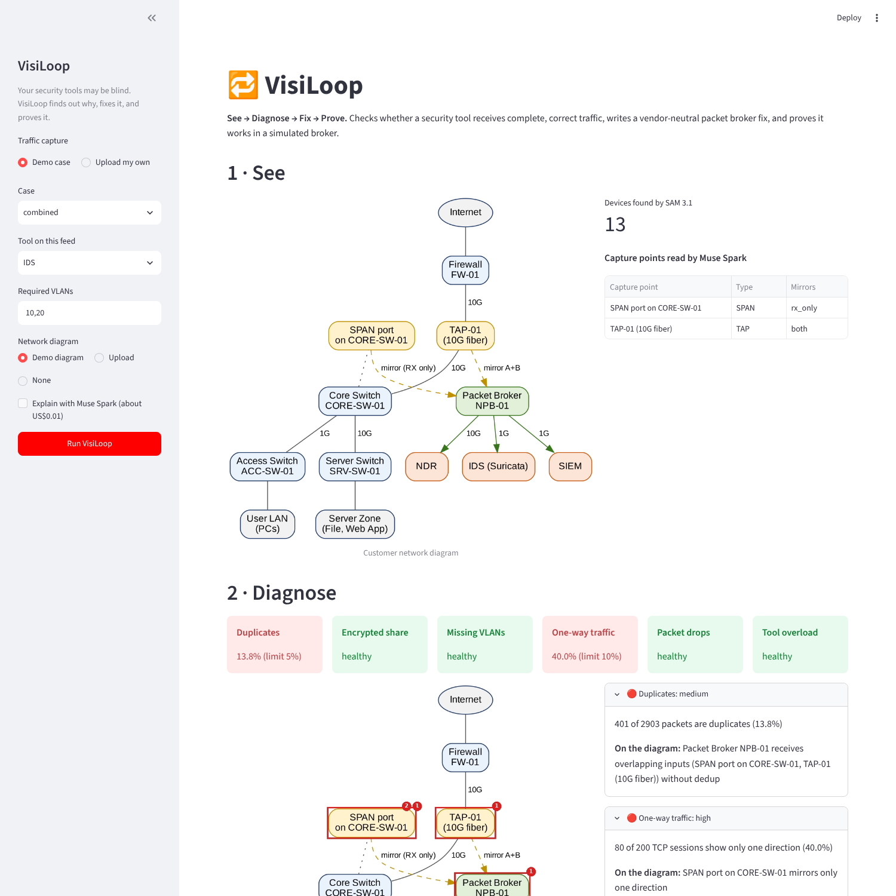
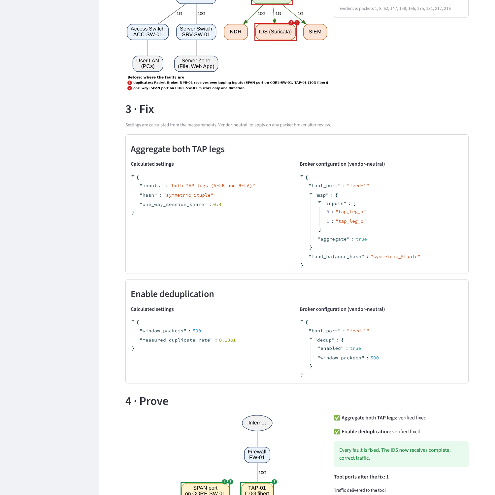
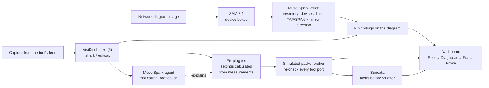
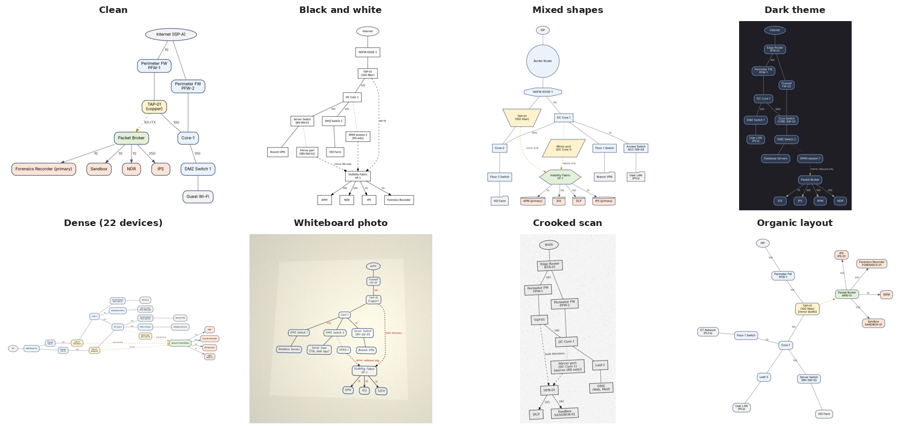

# VisiLoop

**Your security tools may be blind. VisiLoop finds out why, fixes it, and proves it.**

**▶ Demo video (2 min): [youtu.be/Jd9V8uX0U1g](https://youtu.be/Jd9V8uX0U1g)** · **Live demo: [visiloop.streamlit.app](https://visiloop.streamlit.app/)** (no sign-in needed; open the sidebar,
keep the *breach* case and click **Run VisiLoop**. If the app is asleep, click to wake it and wait about a minute.)

Security tools such as IDS, NDR and SIEM can only detect what the network feeds them. In real deployments
those feeds, delivered by TAPs, SPAN ports and packet brokers, are often silently broken: packets dropped in
bursts, duplicated, missing one direction of a conversation, untagged, or encrypted beyond what the tool can
inspect. The tools keep running and their dashboards look normal, so nobody notices that detection has failed.

VisiLoop is an AI visibility engineer built on Meta's models. It closes the loop from diagnosis to a verified fix:

| Step | What happens |
|---|---|
| **See** | SAM 3.1 finds every device on the customer's network diagram; Muse Spark reads it into an inventory, including which way each TAP or SPAN mirrors. |
| **Diagnose** | Nine checks measure the tool's feed. A Muse Spark agent calls them as tools, explains the root cause and pins each fault onto the diagram. |
| **Fix** | Each fault gets a vendor-neutral packet broker change with settings calculated from the measurements. |
| **Prove** | A simulated broker applies the fixes and every tool port is re-checked. Suricata then shows the alert the tool was missing. |

Built for the Meta Global AI Developer Hackathon (Indie Developer track, theme: Build for Your World).




## Architecture



## How Meta's models are used

| Model | Role |
|---|---|
| **SAM 3.1** | Segments every device box on the diagram, giving exact positions for pinning faults. |
| **Muse Spark (vision)** | Reads the diagram with numbered boxes (set-of-marks prompting) into a structured inventory: device types, link speeds, capture points and the direction each mirrors. |
| **Muse Spark (agent)** | Calls the nine checks and the tool profile as tools, in parallel, and returns a structured diagnosis: root cause, impact on the tool, recommended fix and evidence packets. |
| **Muse Code** | Used during development. |

## Results

Measured on 13 synthetic test cases: 6 single-fault, 3 mild (below threshold, must not alarm),
2 with combined faults, a healthy baseline and the breach case. Numbers as of 27 Oct 2026.

| What | Result |
|---|---|
| Fault checks | **11/11** injected faults found, **0** missed, **0** false alarms |
| Muse Spark diagnosis | **13/13** cases diagnosed correctly, **11/11** sensible fixes, **0** ungrounded claims |
| Fixes proven by simulation | **9/9** fixable faults verified fixed; 2 decryption items reported as advice |
| Diagram reading | **13/13** devices found; RX-only SPAN and both-direction TAP read correctly |
| Detection proof | Suricata: **0** alerts on the broken feed → **1** alert after VisiLoop's fix |
| Cost and speed | About **US$0.01** and **9 seconds** per Muse Spark diagnosis (US$0.135 for all 13 cases) |

Example: a 6.51 Gbps burst against a 1 Gbps IDS port. VisiLoop calculates a 13-port load-balanced tool group
with symmetric hashing (every port's peak at or below 0.70 Gbps), or one 10 Gbps port as the alternative.

### Benchmark suite: 200 cases, nine faults (29 Oct 2026)

A generated suite across IDS, NDR, APM and SIEM tools: healthy feeds, below-threshold noise that must not alarm,
one to three faults per case, 45 near-threshold cases, and tool-awareness traps (heavy TLS, untagged, one-way,
sliced or jumbo traffic on a tool that tolerates it). The answer key is computed from the generated packets,
independently of VisiLoop's checks. Full details: [bench/suite/RESULTS.md](bench/suite/RESULTS.md).

| What | Result |
|---|---|
| Muse Spark diagnosis | **200/200** cases exactly right: **235/235** faults, **0** false alarms, **0** ungrounded claims |
| Fix choice | **235/235** sensible |
| Fault checks | **200/200** cases exactly right |
| Fixes proven by simulation | **185/185** fixable faults verified fixed, every faulty case healthy afterwards |
| Cost and speed | **US$2.23** for 200 diagnoses (about US$0.01 each), median **9.9 s** |

**How the suite made VisiLoop better.** Each round of testing found something real, and each was fixed:

- **v1: Muse Spark found a gap in our own checks.** It disagreed with the answer key on four SIEM cases with one-way
  traffic, explaining each time that a SIEM does not need both directions. It was right: the one-way check ignored
  the tool profile. The check is now tool-aware, and Muse Spark scored 200/200 on v2.
- **v3: three new faults exposed two old bugs.** Packet slicing made the drop check raise false alarms (it now
  measures segments by their IP-stated length), and tunnels exposed that the encrypted-traffic check missed
  client acknowledgements to port 443. Both are fixed.
- **v3: Muse Spark improved a fix.** For oversize frames on a SIEM it chose "trim frames to fit" over raising the MTU.
  A SIEM does not need the payload, so that is the better fix; VisiLoop now applies it and verifies it.
- **v3: clearer evidence, better answers.** On its first v3 run Muse Spark chose 229/235 sensible fixes (224 before
  "trim to fit" was accepted for SIEM); most misses
  blamed drops on slicing because our finding said "the feed is sliced". After rewording the finding to state that
  slicing had been ruled out, the second run chose **235/235**.

Earlier results: [v1](bench/suite/results/RESULTS_v1.md), [v2](bench/suite/results/RESULTS_v2.md),
[v3 first run](bench/suite/results/RESULTS_v3_first_run.md).

### Diagram stress test: 36 diagrams, 9 styles (28 Oct 2026)



Generated network diagrams with an exact answer key (536 devices, 71 capture points, 114 tools), drawn as clean
vendor-style diagrams, black-and-white "Visio" drawings, mixed shapes, dark themes, dense 22-device diagrams,
organic layouts, handwritten whiteboard photos and crooked scans. Mirror directions are written in varied wording
("ingress only", "RX+TX", "mirror: outbound only"), on the mirror line or inside the device label.
Full details: [bench/diagrams/RESULTS.md](bench/diagrams/RESULTS.md).

| What | Result |
|---|---|
| SAM 3.1 devices found | **534/536**, **0** false boxes |
| Muse Spark labels read | **534/534** |
| Capture-point mirror direction | **69/69** correct wherever SAM found the capture point |
| Tool port speeds | **114/114** |
| Diagrams ready to pin findings on | **34/36**; the other 2 warn by name about the one capture point SAM could not locate |
| Cost | **US$2.96** for the whole test, including the comparison runs |

**The test changed the product.** With VisiLoop's original two SAM prompts, 98% of devices were found; every miss
was an unusual shape (hexagons, trapezoids, parallelograms). Comparing nine prompts showed that adding just
"hexagon" lifts this to 99.6% with no false boxes, so it is now the default. The last two misses, SPAN sessions
drawn as parallelograms, were found by no prompt, so Muse Spark now also lists any device it can see that has no
tag, and the dashboard warns: "SPAN-2 is on the diagram but SAM 3.1 did not locate it". Both misses were flagged,
with no false flags. Nothing is missed silently.

## Quick start

Requirements: Python 3.11+, [Wireshark](https://www.wireshark.org/) with TShark, and optionally Suricata
for the detection proof (on Windows, install it inside WSL Ubuntu: `sudo apt install suricata`).
A Meta Model API key is needed for live Muse Spark diagnosis and for reading new diagrams. Without a key, the
dashboard shows recorded real Muse Spark runs for the demo cases (`demo/agent_runs/`, labelled with their date)
and the saved reading of the demo diagram, so it works anywhere at no cost.

```bash
pip install -r requirements.txt
export MODEL_API_KEY=...            # Windows: setx MODEL_API_KEY ...

python bench/inject.py              # generate the 13 test cases
python -m streamlit run ui/app.py   # dashboard
```

Command-line tools:
```bash
python bench/run_bench.py --detail                          # fault checks (free)
python bench/run_loop_bench.py                              # diagnose -> fix -> prove (free)
python bench/run_agent_bench.py                             # Muse Spark diagnosis (~US$0.14); also records runs for the public demo
python bench/run_breach_demo.py                             # Suricata 0 -> 1 alert
python -m visikit.agent.diagnose bench/cases/one_way.pcap --tool IDS
python -m visikit.vision.diagram demo/diagram.png --pcap bench/cases/combined.pcap --tool IDS
```

## The nine checks

Every check is tool-aware: it is judged against what that tool type needs (`visikit/profiles/tools.yaml`).

| Check | Measures | Fault when | Fix |
|---|---|---|---|
| Duplicates | Packets removed by deduplication | over 5% | deduplication |
| One-way traffic | TCP sessions with only one side seen | over 10%, for tools that need both directions | aggregate both TAP legs |
| Packet drops | Data the endpoints exchanged but the capture is missing | over 1% of TCP packets | replace the SPAN with a TAP |
| Tool overload | Peak 1 ms burst vs the tool's port speed | over 80% | load-balanced tool group, sized |
| Encrypted share | TLS/QUIC share of bytes | above the tool's tolerance | decryption point (advice) |
| Missing VLANs | Required VLANs absent, or untagged traffic | any missing, or over 5% untagged | preserve VLAN tags |
| Packet slicing | Frames shorter than their IP header states | over 5%, for tools that need the full payload | turn slicing off |
| Tunnel headers | Traffic still inside ERSPAN, GRE or VXLAN | over 10% | strip tunnel headers |
| Oversize frames | Frames above the tool port's maximum frame size | over 1% | raise the MTU (advice) |

The fix loop applies the fixes in a simulated broker and re-checks the result: port capacity per tool port,
everything else on the tool group as a whole. If a fix reveals a fault the broken feed was hiding (aggregating
both directions doubles the load; turning slicing off brings back jumbo frames), it plans another round.

## VisiKit: the plug-in framework

Every check and every fix is a small plug-in. The agent, simulator, benchmark and dashboard pick them up
automatically, so new fault types or vendor integrations take hours, not weeks.

```python
from visikit.core.registry import detector
from visikit.core.schema import FeedContext, Finding

@detector
class MyCheck:
    fault = "my_fault"
    def run(self, ctx: FeedContext) -> list[Finding]:
        ...
```

```
visikit/
  core/        common data format, plug-in registry, tshark helpers
  detectors/   one file per fault
  fixes/       one file per fix: dedup, aggregate, replace_span_with_tap, load_balance, vlan, decrypt_advice,
               disable_slicing, strip_tunnel, mtu_advice
  agent/       Muse Spark diagnosis agent
  vision/      SAM 3.1 + Muse Spark diagram reading and pinning
  proof/       Suricata detection proof and test rule
  profiles/    what each tool type needs (NDR, IDS, APM, SIEM)
  loop.py      diagnose -> fix -> prove
bench/         test-case generator and benchmarks
ui/app.py      Streamlit dashboard
```

## Design choices

- **Grounded diagnosis.** The agent can only report faults a check actually found; anything else is removed and counted.
- **Calculated, not guessed.** Fix settings (for example, the number of load-balanced ports) come from the measurements. Muse Spark chooses and explains.
- **Proof, not promises.** Fixes are applied in a simulated broker and re-checked. A fix that cannot be simulated offline (decryption) is reported as advice.
- **Privacy.** Only check results and short packet references go to the model, never packet contents. Diagram images are sent to the Meta Model API for reading, once, and the result is cached.
- **Suricata note.** Traffic routed between VLANs carries a different tag in each direction, so Suricata runs with `vlan.use-for-tracking=false` to keep both directions in one flow.

## Responsible use and limitations

VisiLoop is a defensive tool for network owners to make sure their own monitoring receives complete traffic.
It never pushes changes to equipment; every fix needs engineer approval. The model prompts are framed around
improving detection coverage of the owner's own network.

The test data is synthetic, generated by `bench/`. The detection-proof rule (`visikit/proof/visiloop.rules`) is
a harmless test signature that matches only that traffic. Diagram reading works best on clear diagrams with
labelled boxes. Pinpointing exactly where a drop happens needs switch and broker counters, which is future work.
