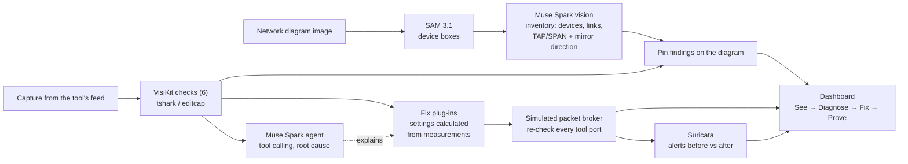

# VisiLoop

**Your security tools may be blind. VisiLoop finds out why, fixes it, and proves it.**

Security tools such as IDS, NDR and SIEM can only detect what the network feeds them. In real deployments
those feeds, delivered by TAPs, SPAN ports and packet brokers, are often silently broken: packets dropped in
bursts, duplicated, missing one direction of a conversation, untagged, or encrypted beyond what the tool can
inspect. The tools keep running and their dashboards look normal, so nobody notices that detection has failed.

VisiLoop is an AI visibility engineer built on Meta's models. It closes the loop from diagnosis to a verified fix:

| Step | What happens |
|---|---|
| **See** | SAM 3.1 finds every device on the customer's network diagram; Muse Spark reads it into an inventory, including which way each TAP or SPAN mirrors. |
| **Diagnose** | Six checks measure the tool's feed. A Muse Spark agent calls them as tools, explains the root cause and pins each fault onto the diagram. |
| **Fix** | Each fault gets a vendor-neutral packet broker change with settings calculated from the measurements. |
| **Prove** | A simulated broker applies the fixes and every tool port is re-checked. Suricata then shows the alert the tool was missing. |

Built for the Meta Global AI Developer Hackathon (Indie Developer track, theme: Build for Your World).


## Architecture



## How Meta's models are used

| Model | Role |
|---|---|
| **SAM 3.1** | Segments every device box on the diagram, giving exact positions for pinning faults. |
| **Muse Spark (vision)** | Reads the diagram with numbered boxes (set-of-marks prompting) into a structured inventory: device types, link speeds, capture points and the direction each mirrors. |
| **Muse Spark (agent)** | Calls the six checks and the tool profile as tools, in parallel, and returns a structured diagnosis: root cause, impact on the tool, recommended fix and evidence packets. |
| **Muse Code** | Used during development. |

## Results

Measured on 13 synthetic test cases: 6 single-fault, 3 mild (below threshold, must not alarm),
2 with combined faults, a healthy baseline and the breach case. Numbers as of 27 Oct 2026.

| What | Result |
|---|---|
| Fault checks | **11/11** injected faults found, **0** missed, **0** false alarms |
| Muse Spark diagnosis | **12/12** cases diagnosed correctly, **10/10** sensible fixes, **0** ungrounded claims |
| Fixes proven by simulation | **9/9** fixable faults verified fixed; 2 decryption items reported as advice |
| Diagram reading | **13/13** devices found; RX-only SPAN and both-direction TAP read correctly |
| Detection proof | Suricata: **0** alerts on the broken feed → **1** alert after VisiLoop's fix |
| Cost and speed | About **US$0.01** and **10 seconds** per Muse Spark diagnosis |

Example: a 6.51 Gbps burst against a 1 Gbps IDS port. VisiLoop calculates a 13-port load-balanced tool group
with symmetric hashing (every port's peak at or below 0.70 Gbps), or one 10 Gbps port as the alternative.

## Quick start

Requirements: Python 3.11+, [Wireshark](https://www.wireshark.org/) with TShark, and optionally Suricata
for the detection proof (on Windows, install it inside WSL Ubuntu: `sudo apt install suricata`).
A Meta Model API key is needed for the agent and diagram reading.

```bash
pip install -r requirements.txt
export MODEL_API_KEY=...            # Windows: setx MODEL_API_KEY ...

python bench/inject.py              # generate the 13 test cases
python -m streamlit run ui/app.py   # dashboard
```

Command-line tools:
```bash
python bench/run_bench.py --detail                          # fault checks (free)
python bench/run_loop_bench.py                              # diagnose -> fix -> prove (free)
python bench/run_agent_bench.py                             # Muse Spark diagnosis (~US$0.15)
python bench/run_breach_demo.py                             # Suricata 0 -> 1 alert
python -m visikit.agent.diagnose bench/cases/one_way.pcap --tool IDS
python -m visikit.vision.diagram demo/diagram.png --pcap bench/cases/combined.pcap --tool IDS
```

## The six checks

| Check | Measures | Fault when |
|---|---|---|
| Duplicates | Packets removed by deduplication | over 5% |
| One-way traffic | TCP sessions with only one side seen | over 10% |
| Packet drops | ACKs for data missing from the capture | over 1% of TCP packets |
| Tool overload | Peak 1 ms burst vs the tool's port speed | over 80% |
| Encrypted share | TLS/QUIC share of bytes | above the tool's tolerance |
| Missing VLANs | Required VLANs absent, or untagged traffic | any missing, or over 5% untagged |

## VisiKit: the plug-in framework

Every check and every fix is a small plug-in. The agent, simulator, benchmark and dashboard pick them up
automatically, so new fault types or vendor integrations take hours, not weeks.

```python
from visikit.core.registry import detector
from visikit.core.schema import FeedContext, Finding

@detector
class MyCheck:
    fault = "my_fault"
    def run(self, ctx: FeedContext) -> list[Finding]:
        ...
```

```
visikit/
  core/        common data format, plug-in registry, tshark helpers
  detectors/   one file per fault
  fixes/       one file per fix: dedup, aggregate, replace_span_with_tap, load_balance, vlan, decrypt_advice
  agent/       Muse Spark diagnosis agent
  vision/      SAM 3.1 + Muse Spark diagram reading and pinning
  proof/       Suricata detection proof and test rule
  profiles/    what each tool type needs (NDR, IDS, APM, SIEM)
  loop.py      diagnose -> fix -> prove
bench/         test-case generator and benchmarks
ui/app.py      Streamlit dashboard
```

## Design choices

- **Grounded diagnosis.** The agent can only report faults a check actually found; anything else is removed and counted.
- **Calculated, not guessed.** Fix settings (for example, the number of load-balanced ports) come from the measurements. Muse Spark chooses and explains.
- **Proof, not promises.** Fixes are applied in a simulated broker and re-checked. A fix that cannot be simulated offline (decryption) is reported as advice.
- **Privacy.** Only check results and short packet references go to the model, never packet contents. Diagram images are sent to the Meta Model API for reading, once, and the result is cached.
- **Suricata note.** Traffic routed between VLANs carries a different tag in each direction, so Suricata runs with `vlan.use-for-tracking=false` to keep both directions in one flow.

## Responsible use and limitations

VisiLoop is a defensive tool for network owners to make sure their own monitoring receives complete traffic.
It never pushes changes to equipment; every fix needs engineer approval. The model prompts are framed around
improving detection coverage of the owner's own network.

The test data is synthetic, generated by `bench/`. The detection-proof rule (`visikit/proof/visiloop.rules`) is
a harmless test signature that matches only that traffic. Diagram reading works best on clear diagrams with
labelled boxes. Pinpointing exactly where a drop happens needs switch and broker counters, which is future work.
