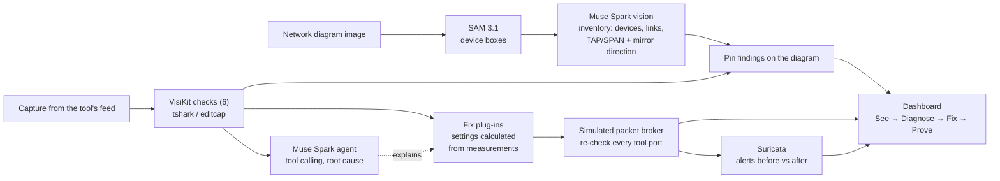
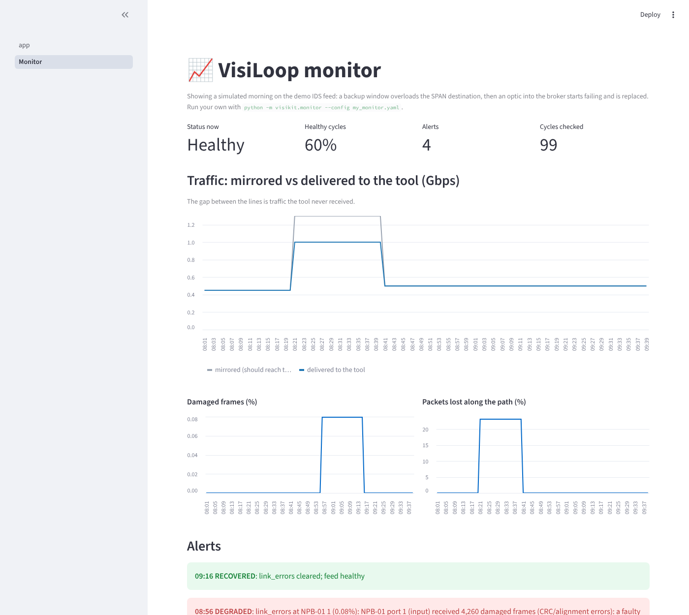

# VisiLoop

**Your security tools may be blind. VisiLoop finds out why, fixes it, and proves it.**

**▶ Demo video (2 min): [youtu.be/Jd9V8uX0U1g](https://youtu.be/Jd9V8uX0U1g)** · **▶ Since the video (73 s): [youtu.be/gEjxrXi8b6c](https://youtu.be/gEjxrXi8b6c)** · **Live demo: [visiloop.streamlit.app](https://visiloop.streamlit.app/)** (no sign-in needed; open the sidebar,
keep the *breach* case and click **Run VisiLoop**. If the app is asleep, click to wake it and wait about a minute.)

### Since the demo video (updated 29 Oct 2026)

The video shows VisiLoop on 13 synthetic cases. Since then it has been tested much harder, and each round of tests
found and fixed real problems (73-second update: [youtu.be/gEjxrXi8b6c](https://youtu.be/gEjxrXi8b6c)):

| Test | Result |
|---|---|
| [Benchmark suite](bench/suite/RESULTS.md): 200 cases, nine faults, alone and combined, with near-threshold traps | checks **200/200**; Muse Spark **200/200** faults and **235/235** fixes |
| [Counter benchmark](bench/counters/RESULTS.md): 100 feed paths, where is the loss? | **100/100** located to the device and port; Muse Spark **69/69** faults, **68/69** fixes |
| [Diagram stress test](bench/diagrams/RESULTS.md): 36 diagrams in 9 drawing styles | **534/536** devices found; **34/36** ready to pin, the two misses flagged |
| [Soft lab](lab/softlab/RESULTS.md): real traffic on a virtual switch and packet broker, real SNMP | **16/16** capture tests, **5/5** counter tests, monitoring with **0** false alarms |

New in the live demo: in the sidebar's **Case** list, the four **Real traffic** cases are recordings from the soft
lab (a receive-only SPAN, an overloaded SPAN port, packet slicing, ERSPAN left wrapped). **Path counters** adds
interface counters that name the switch or broker port where packets are lost. The **Monitor** page replays a
morning of continuous monitoring with alerts.

Security tools such as IDS, NDR and SIEM can only detect what the network feeds them. In real deployments
those feeds, delivered by TAPs, SPAN ports and packet brokers, are often silently broken: packets dropped in
bursts, duplicated, missing one direction of a conversation, untagged, or encrypted beyond what the tool can
inspect. The tools keep running and their dashboards look normal, so nobody notices that detection has failed.

VisiLoop is an AI visibility engineer built on Meta's models. It closes the loop from diagnosis to a verified fix:

| Step | What happens |
|---|---|
| **See** | SAM 3.1 finds every device on the customer's network diagram; Muse Spark reads it into an inventory, including which way each TAP or SPAN mirrors. |
| **Diagnose** | Nine checks measure the tool's feed, and two more read interface counters along its path to find where loss happens. A Muse Spark agent calls them as tools, explains the root cause and pins each fault onto the diagram. |
| **Fix** | Each fault gets a vendor-neutral packet broker change with settings calculated from the measurements. |
| **Prove** | A simulated broker applies the fixes and every tool port is re-checked. Suricata then shows the alert the tool was missing. |

Built for the Meta Global AI Developer Hackathon (Indie Developer track, theme: Build for Your World).


## Architecture



## How Meta's models are used

| Model | Role |
|---|---|
| **SAM 3.1** | Segments every device box on the diagram, giving exact positions for pinning faults. |
| **Muse Spark (vision)** | Reads the diagram with numbered boxes (set-of-marks prompting) into a structured inventory: device types, link speeds, capture points and the direction each mirrors. |
| **Muse Spark (agent)** | Calls the checks (from a capture, from counters, or both) and the tool profile as tools, in parallel, and returns a structured diagnosis: root cause, impact on the tool, recommended fix and evidence packets. |
| **Muse Code** | Used during development. |

## Results

Measured on 13 synthetic test cases: 6 single-fault, 3 mild (below threshold, must not alarm),
2 with combined faults, a healthy baseline and the breach case. Numbers as of 27 Oct 2026.

| What | Result |
|---|---|
| Fault checks | **11/11** injected faults found, **0** missed, **0** false alarms |
| Muse Spark diagnosis | **13/13** cases diagnosed correctly, **11/11** sensible fixes, **0** ungrounded claims |
| Fixes proven by simulation | **9/9** fixable faults verified fixed; 2 decryption items reported as advice |
| Diagram reading | **13/13** devices found; RX-only SPAN and both-direction TAP read correctly |
| Detection proof | Suricata: **0** alerts on the broken feed → **1** alert after VisiLoop's fix |
| Cost and speed | About **US$0.01** and **9 seconds** per Muse Spark diagnosis (US$0.135 for all 13 cases) |

Example: a 6.51 Gbps burst against a 1 Gbps IDS port. VisiLoop calculates a 13-port load-balanced tool group
with symmetric hashing (every port's peak at or below 0.70 Gbps), or one 10 Gbps port as the alternative.

### Benchmark suite: 200 cases, nine faults (29 Oct 2026)

A generated suite across IDS, NDR, APM and SIEM tools: healthy feeds, below-threshold noise that must not alarm,
one to three faults per case, 45 near-threshold cases, and tool-awareness traps (heavy TLS, untagged, one-way,
sliced or jumbo traffic on a tool that tolerates it). The answer key is computed from the generated packets,
independently of VisiLoop's checks. Full details: [bench/suite/RESULTS.md](bench/suite/RESULTS.md).

| What | Result |
|---|---|
| Muse Spark diagnosis | **200/200** cases exactly right: **235/235** faults, **0** false alarms, **0** ungrounded claims |
| Fix choice | **235/235** sensible |
| Fault checks | **200/200** cases exactly right |
| Fixes proven by simulation | **185/185** fixable faults verified fixed, every faulty case healthy afterwards |
| Cost and speed | **US$2.23** for 200 diagnoses (about US$0.01 each), median **9.9 s** |

**How the suite made VisiLoop better.** Each round of testing found something real, and each was fixed:

- **v1: Muse Spark found a gap in our own checks.** It disagreed with the answer key on four SIEM cases with one-way
  traffic, explaining each time that a SIEM does not need both directions. It was right: the one-way check ignored
  the tool profile. The check is now tool-aware, and Muse Spark scored 200/200 on v2.
- **v3: three new faults exposed two old bugs.** Packet slicing made the drop check raise false alarms (it now
  measures segments by their IP-stated length), and tunnels exposed that the encrypted-traffic check missed
  client acknowledgements to port 443. Both are fixed.
- **v3: Muse Spark improved a fix.** For oversize frames on a SIEM it chose "trim frames to fit" over raising the MTU.
  A SIEM does not need the payload, so that is the better fix; VisiLoop now applies it and verifies it.
- **v3: clearer evidence, better answers.** On its first v3 run Muse Spark chose 229/235 sensible fixes (224 before
  "trim to fit" was accepted for SIEM); most misses
  blamed drops on slicing because our finding said "the feed is sliced". After rewording the finding to state that
  slicing had been ruled out, the second run chose **235/235**.

Earlier results: [v1](bench/suite/results/RESULTS_v1.md), [v2](bench/suite/results/RESULTS_v2.md),
[v3 first run](bench/suite/results/RESULTS_v3_first_run.md).

### Counter benchmark: where is the loss? 100 paths (29 Oct 2026)

Simulated feed paths (SPAN or TAP into a broker, with or without the tool's own counters, 1G or 10G ports), each
with up to two faults: SPAN oversubscription, broker congestion, damaged frames, tool capture overrun and loss on a
link, plus below-threshold noise. The answer key records each fault and where it is. Muse Spark diagnoses from
counters alone, with no capture. Full details: [bench/counters/RESULTS.md](bench/counters/RESULTS.md).

| What | Result |
|---|---|
| Counter checks: right fault at the right device and port | **100/100**; quiet on all 31 healthy or noise-only paths |
| VisiLoop's fix suited to where the problem is | **69/69** |
| Muse Spark diagnosis from counters alone | **69/69** exactly right, **0** ungrounded claims |
| Muse Spark fix choice | **68/69**; the one difference was a better fix (below) |
| Cost | **US$0.89** for 69 diagnoses |

**Muse Spark improved a fix again.** For a congested 1 Gbps broker port feeding an NDR, it recommended upgrading
the port to 10 Gbps, because the NDR's profile accepts 10 Gbps, instead of building a tool group of 1G ports.
That is simpler and better, so VisiLoop's own fix is now tool-aware in the same way: it upgrades the port when the
tool can take it, and load-balances otherwise. Reviewing that case also showed tool groups were sized from the
traffic the port delivered rather than the traffic offered to it; they are now sized from the offered load.

### Diagram stress test: 36 diagrams, 9 styles (28 Oct 2026)


Generated network diagrams with an exact answer key (536 devices, 71 capture points, 114 tools), drawn as clean
vendor-style diagrams, black-and-white "Visio" drawings, mixed shapes, dark themes, dense 22-device diagrams,
organic layouts, handwritten whiteboard photos and crooked scans. Mirror directions are written in varied wording
("ingress only", "RX+TX", "mirror: outbound only"), on the mirror line or inside the device label.
Full details: [bench/diagrams/RESULTS.md](bench/diagrams/RESULTS.md).

| What | Result |
|---|---|
| SAM 3.1 devices found | **534/536**, **0** false boxes |
| Muse Spark labels read | **534/534** |
| Capture-point mirror direction | **69/69** correct wherever SAM found the capture point |
| Tool port speeds | **114/114** |
| Diagrams ready to pin findings on | **34/36**; the other 2 warn by name about the one capture point SAM could not locate |
| Cost | **US$2.96** for the whole test, including the comparison runs |

**The test changed the product.** With VisiLoop's original two SAM prompts, 98% of devices were found; every miss
was an unusual shape (hexagons, trapezoids, parallelograms). Comparing nine prompts showed that adding just
"hexagon" lifts this to 99.6% with no false boxes, so it is now the default. The last two misses, SPAN sessions
drawn as parallelograms, were found by no prompt, so Muse Spark now also lists any device it can see that has no
tag, and the dashboard warns: "SPAN-2 is on the diagram but SAM 3.1 did not locate it". Both misses were flagged,
with no false flags. Nothing is missed silently.

## Quick start

Requirements: Python 3.11+, [Wireshark](https://www.wireshark.org/) with TShark, and optionally Suricata
for the detection proof (on Windows, install it inside WSL Ubuntu: `sudo apt install suricata`).
A Meta Model API key is needed for live Muse Spark diagnosis and for reading new diagrams. Without a key, the
dashboard shows recorded real Muse Spark runs for the demo cases (`demo/agent_runs/`, labelled with their date)
and the saved reading of the demo diagram, so it works anywhere at no cost.

```bash
pip install -r requirements.txt
export MODEL_API_KEY=...            # Windows: setx MODEL_API_KEY ...

python bench/inject.py              # generate the 13 test cases
python -m streamlit run ui/app.py   # dashboard
```

Command-line tools:
```bash
python bench/run_bench.py --detail                          # fault checks (free)
python bench/run_loop_bench.py                              # diagnose -> fix -> prove (free)
python bench/run_agent_bench.py                             # Muse Spark diagnosis (~US$0.14); also records runs for the public demo
python bench/run_breach_demo.py                             # Suricata 0 -> 1 alert
python -m visikit.agent.diagnose bench/cases/one_way.pcap --tool IDS
python -m visikit.vision.diagram demo/diagram.png --pcap bench/cases/combined.pcap --tool IDS
```

## The checks

Nine checks read a capture from the tool port; two more read interface counters along the feed's path.
Every check is tool-aware: it is judged against what that tool type needs (`visikit/profiles/tools.yaml`).

| Check | Measures | Fault when | Fix |
|---|---|---|---|
| Duplicates | Packets removed by deduplication | over 5% | deduplication |
| One-way traffic | TCP sessions with only one side seen | over 10%, for tools that need both directions | aggregate both TAP legs |
| Packet drops | Data the endpoints exchanged but the capture is missing (not counted: gaps a retransmission fills later, i.e. network loss the feed rightly shows, and an ACK up to 10 ms ahead of its data when a broker merges two TAP legs) | over 1% of TCP packets | replace the SPAN with a TAP |
| Tool overload | Peak 1 ms burst vs the tool's port speed | over 80% | load-balanced tool group, sized |
| Encrypted share | TLS/QUIC share of bytes | above the tool's tolerance | decryption point (advice) |
| Missing VLANs | Required VLANs absent, or untagged traffic | any missing, or over 5% untagged | preserve VLAN tags |
| Packet slicing | Frames shorter than their IP header states | over 5%, or most of the frames long enough to be cut (a feed of mostly small ACKs hides slicing), for tools that need the full payload | turn slicing off |
| Tunnel headers | Traffic still inside ERSPAN, GRE or VXLAN | over 10% | strip tunnel headers |
| Oversize frames | Frames above the tool port's maximum frame size | over 1% | trim to fit (SIEM, APM), or raise the MTU (advice) |
| Loss along the path | Interface counters at each hop: SPAN source and destination, broker in and out, tool | over 0.1% at one place | depends on where: TAP instead of SPAN, a port matching the tool or a sized tool group, tool capacity, check the link |
| Link errors | Damaged frames (CRC) received at a hop | over 0.001% | replace the cable or optic, check duplex |

The fix loop applies the fixes in a simulated broker and re-checks the result: port capacity per tool port,
everything else on the tool group as a whole. If a fix reveals a fault the broken feed was hiding (aggregating
both directions doubles the load; turning slicing off brings back jumbo frames), it plans another round.

## Counters, continuous monitoring and the lab kit

**Where is the loss?** A capture shows that packets are missing; interface counters show where. VisiLoop reads
standard interface counters (IF-MIB over SNMP, supported by virtually every switch and packet broker) at each hop
of a feed's path and compares neighbours, so a finding names the device and port: "the SPAN session should copy
15,000,000 packets but CORE-SW-01 Gi1/0/48 sent only 10,714,260: 1.40 Gbps mirrored into a 1 Gbps port".

```
python -m visikit.counters --path demo/counters/span_oversubscribed.yaml          # simulated scenarios in demo/counters/
python -m visikit.counters --path my_path.yaml --snmp --seconds 60 --tool IDS      # real devices
```

In the dashboard, the sidebar's **Path counters** option adds a simulated counter scenario to any case, so a
capture finding and a located counter finding appear side by side, with a hop-by-hop counter table and pins on the
diagram.

**Continuous mode** checks every feed on a schedule (counters every cycle, an optional short capture every few
cycles), keeps history in SQLite, and alerts when a feed degrades or recovers: console, log file, or a Teams /
Slack / generic webhook, optionally with a Muse Spark explanation. The dashboard's **Monitor** page shows status,
mirrored vs delivered traffic, loss over time and the alert log.

```
python -m visikit.monitor --config demo/monitor.yaml --fast      # replay a simulated morning in seconds
python -m visikit.monitor --config my_monitor.yaml               # real feeds, runs until stopped
```



**Soft lab** (`lab/softlab/`): the lab tests with no equipment. A virtual lab built from real Linux network
interfaces: a lab client and server exchanging real HTTP, HTTPS, DNS and iperf3 traffic, a software switch (TAP
legs, SPAN, ERSPAN), a software packet broker (rules, slicing, VLAN tagging and stripping, deduplication, ERSPAN
stripping), a tool port recorded with dumpcap, and live SNMP on both devices. Frames carry broker-style hardware
timestamps, so the recordings keep real-port timing. One command (`sudo python3 -m lab.softlab.run`, Linux or
WSL 2) runs everything in about 30 minutes. Results (29 Oct 2026):

| Soft lab | Result |
|---|---|
| Capture tests (L01-L12, L14, and the fixes L03b, L08b, L14b proven on the same setup) | **16/16** exactly right |
| Counter tests over SNMP (healthy, SPAN oversubscription, broker congestion, link loss, damaged frames) | **5/5** located at the right port |
| Continuous monitoring, polling every 5 s while three faults come and go | each fault raised **once** at the right place and cleared when it ended; **0** false alarms |

Building it found real problems in VisiLoop, now fixed (the 200-case suite and the counter benchmark were re-run
afterwards: still 200/200 and 100/100):
- **Slicing hidden by a receive-only SPAN.** The tool saw mostly 66-byte ACKs, so only 0.5% of frames were cut,
  under the 5% limit, although 100% of the frames long enough to cut were. The check now also judges the frames
  long enough to be sliced.
- **Network loss reported as monitoring loss.** A gap in a TCP stream that a retransmission fills later was lost
  on the network before the TAP: the feed shows what was on the wire. It no longer counts as a visibility fault,
  and neither does an ACK seen up to 10 ms before its data (normal when a broker merges two TAP legs). An ACK for
  data the capture never saw still does.
- **Counter readings taken too far apart.** VisiLoop read the devices one after the other; on a busy link, the
  time between readings looked like loss. It now reads every device at once (one request per device), records
  when each answered, and does not call a difference loss when the time between readings could explain it.
- **One alert per fault type.** When loss moved from one port to another, the monitor stayed silent. Alerts are
  now per fault and place.

It also corrected the real-lab plan: at full 1G speed, the standard 50 MB download fills a 1G tool port above the
80% burst limit, so every test would have reported tool overload. The download is now rate-limited, and the
tests that really fill the tool port expect that finding too. See [lab/softlab/README.md](lab/softlab/README.md)
and [lab/softlab/RESULTS.md](lab/softlab/RESULTS.md).

**Lab kit** (`lab/`): fifteen tests (one fault each, a fix verified on real equipment, and two multi-link tests), set up on purpose on a Catalyst 9300, a Cubro EXA48800 and Cubro copper, optical and multi-link TAPs (see `lab/LAB_SETUP.md`), with a
capture script and a scorer, to prove every check on real traffic. Lab traffic only. See [lab/README.md](lab/README.md).

## VisiKit: the plug-in framework

Every check and every fix is a small plug-in. The agent, simulator, benchmark and dashboard pick them up
automatically, so new fault types or vendor integrations take hours, not weeks.

```python
from visikit.core.registry import detector
from visikit.core.schema import FeedContext, Finding

@detector
class MyCheck:
    fault = "my_fault"
    def run(self, ctx: FeedContext) -> list[Finding]:
        ...
```

```
visikit/
  core/        common data format, plug-in registry, tshark helpers
  detectors/   one file per fault
  fixes/       one file per fix: dedup, aggregate, replace_span_with_tap, load_balance, vlan, decrypt_advice,
               disable_slicing, strip_tunnel, mtu_advice (trim to fit), path (counter faults)
  agent/       Muse Spark diagnosis agent
  vision/      SAM 3.1 + Muse Spark diagram reading and pinning
  proof/       Suricata detection proof and test rule
  counters/    path model, SNMP reader, simulator, `python -m visikit.counters`
  profiles/    what each tool type needs (NDR, IDS, APM, SIEM)
  loop.py      diagnose -> fix -> prove, with extra rounds when a fix reveals a hidden fault
  monitor.py   continuous mode: schedule, history, alerts
bench/         test-case generators and benchmarks (suite/, diagrams/)
lab/           real-traffic lab kit: plan, capture script, scorer
  softlab/     the same tests on a virtual lab of real Linux interfaces: switch, broker, SNMP, recordings
ui/            Streamlit dashboard (app.py) and Monitor page (pages/)
tests/         fake SNMP agent for testing the reader
```

## Design choices

- **Grounded diagnosis.** The agent can only report faults a check actually found; anything else is removed and counted.
- **Calculated, not guessed.** Fix settings (for example, the number of load-balanced ports) come from the measurements. Muse Spark chooses and explains.
- **Proof, not promises.** Fixes are applied in a simulated broker and re-checked. A fix that cannot be simulated offline (decryption) is reported as advice.
- **Privacy.** Only check results and short packet references go to the model, never packet contents. Diagram images are sent to the Meta Model API for reading, once, and the result is cached.
- **Suricata note.** Traffic routed between VLANs carries a different tag in each direction, so Suricata runs with `vlan.use-for-tracking=false` to keep both directions in one flow.

## Responsible use and limitations

VisiLoop is a defensive tool for network owners to make sure their own monitoring receives complete traffic.
It never pushes changes to equipment; every fix needs engineer approval. The model prompts are framed around
improving detection coverage of the owner's own network.

The test data is synthetic, generated by `bench/`. The detection-proof rule (`visikit/proof/visiloop.rules`) is
a harmless test signature that matches only that traffic. Diagram reading works best on clear diagrams with
labelled boxes. SNMP access should use a read-only community on a monitoring network, restricted to the
VisiLoop host. The lab kit asks for confirmation that only lab traffic is captured, and captures are not
committed to git.
